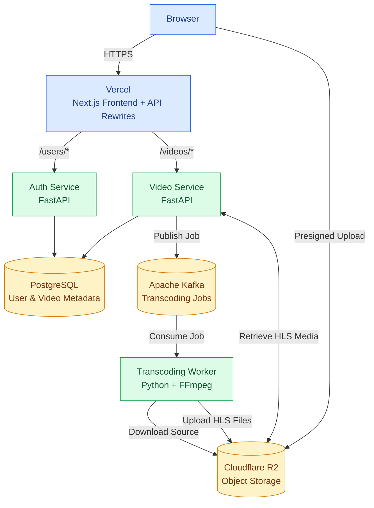
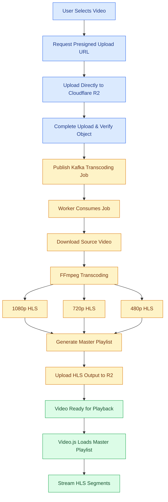
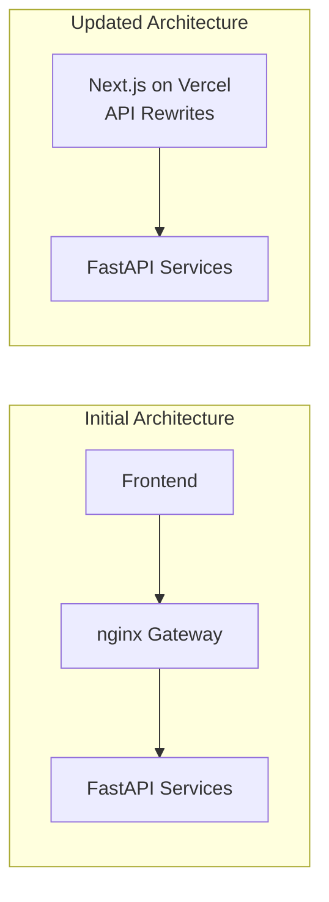

# 🎬 WeTube — Distributed Video Streaming Platform

**A full-stack video streaming platform built with microservices, event-driven video processing, and adaptive HTTP Live Streaming (HLS).**

WeTube is a YouTube-inspired video streaming application that enables users to securely upload, process, and stream videos in multiple resolutions.

Built using **Next.js, FastAPI, Apache Kafka, FFmpeg, PostgreSQL, Cloudflare R2, and Vercel**, WeTube demonstrates how to design a video-processing system with asynchronous workloads, independent backend services, cloud object storage, and efficient media delivery.

The core engineering challenge is handling **large video uploads and CPU-intensive transcoding without blocking API requests**. WeTube addresses this using direct-to-cloud uploads, Kafka-based background processing, dedicated FFmpeg workers, and HLS streaming.

## ✨ Features

- **Authentication** — Email/password login, Google OAuth, and JWT authentication with HttpOnly cookies.
- **Cloud Video Uploads** — Presigned URLs for direct browser-to-Cloudflare R2 uploads, with an alternative server-side upload flow.
- **Asynchronous Processing** — Kafka decouples video uploads from CPU-intensive FFmpeg transcoding.
- **Adaptive Streaming** — HLS playback with 1080p, 720p, and 480p video renditions.
- **Video Management** — Video metadata, listing, and retrieval using PostgreSQL.
- **User Profiles** — Profile editing and avatar uploads to object storage.
- **Modern UI** — Responsive Next.js frontend with Tailwind CSS and Video.js.
- **Simplified API Routing** — Vercel rewrites route requests to FastAPI services without a separately deployed API gateway.

---

## 📸 Screenshots

### Home Page

Browse uploaded videos through a responsive video discovery interface.


### Video Player

Stream videos using HLS with multiple available quality levels.


### Video Upload

Upload videos directly to cloud object storage.


### User Engagement

Like, Comment on videos.


### Subscription

Subscribe to channels you like.


> Add actual application screenshots inside the `screenshots/` directory using these filenames.

---

## 🏗️ System Architecture

WeTube uses a microservices-based architecture that separates authentication, video management, and resource-intensive media processing.

The **Next.js frontend is deployed on Vercel**, which also handles frontend-facing API routing using rewrites. Backend requests are forwarded to their respective FastAPI services.



### Service Responsibilities

| Component | Responsibility |
|---|---|
| **Frontend (Next.js)** | Authentication UI, video discovery, uploads, and playback |
| **Vercel API Routing** | Routes frontend-facing API requests to FastAPI services |
| **Auth Service** | Authentication, JWT, Google OAuth, and user profiles |
| **Video Service** | Video metadata, upload authorization, Kafka publishing, and HLS delivery |
| **Transcoding Service** | Consumes Kafka jobs and processes videos using FFmpeg |
| **PostgreSQL** | Persistent storage for user and video metadata |
| **Apache Kafka** | Asynchronous communication between video service and transcoding workers |
| **Cloudflare R2** | Storage for source videos, HLS playlists, segments, and avatars |

### Why Microservices?

Video streaming applications involve workloads with different characteristics:

- **Authentication:** Short, lightweight API requests.
- **Video management:** Metadata operations and coordination with object storage.
- **Transcoding:** Long-running, CPU-intensive media processing.

Separating these workloads makes it possible to manage and scale media-processing workers independently from user-facing API services.

It also keeps authentication and video-processing responsibilities isolated at the application level.

**Trade-off:** Microservices introduce additional networking, deployment complexity, and distributed failure scenarios. For a small application, a monolith may be simpler. This architecture was chosen to explore asynchronous processing and distributed backend design.

---

## 🔄 End-to-End Video Processing Pipeline

The most important part of WeTube is its asynchronous upload-to-playback pipeline.

It converts an uploaded source video into multiple HLS renditions without requiring the HTTP upload request to remain open during video encoding.



### Phase 1 — Direct-to-Cloud Upload

**1. Initiate Upload**

The frontend calls:

`POST /videos/upload/initiate`

The video service generates a temporary presigned Cloudflare R2 URL.

**2. Upload Video**

The browser uploads the source video directly to R2 using the presigned URL.

```text
Traditional Upload:
Browser → Backend Server → Object Storage

WeTube Direct Upload:
Browser ─────────────────→ Cloudflare R2
         Presigned URL
```

**Why presigned URLs?**

Routing large video files through backend servers increases bandwidth consumption and server resource usage.

Presigned URLs allow the backend to control upload authorization while the actual video data travels directly from the browser to object storage.

This reduces unnecessary backend traffic and improves the architecture's ability to handle large uploads.

The application also supports server-mediated uploads as an alternative.

**3. Complete Upload**

After uploading, the frontend calls:

`POST /videos/{id}/complete`

The video service verifies that the uploaded object exists and publishes a transcoding job to Kafka.

Separating upload initiation and completion ensures that transcoding is requested only after the application verifies the source object.

### Phase 2 — Asynchronous Transcoding

**4. Publish Kafka Event**

The video service publishes a message to the `video-transcode-jobs` topic.

Example event:

```json
{
  "video_id": "video-identifier",
  "file_key": "users/123/video/raw/video.mp4",
  "content_type": "video/mp4"
}
```

Only the storage reference and metadata are transmitted through Kafka, not the full video file.

**5. Consume Processing Job**

A dedicated transcoding worker consumes the Kafka event and downloads the source video from R2.

**6. Transcode with FFmpeg**

FFmpeg processes the source into multiple HLS renditions:

| Resolution | Purpose |
|---|---|
| 1080p | High-quality viewing |
| 720p | Balanced playback |
| 480p | Lower-bandwidth playback |

For each rendition, FFmpeg generates a media playlist (`.m3u8`) and segmented video files (`.ts`).

A master playlist connects the available renditions.

**Why asynchronous processing?**

Video encoding may take significant processing time and CPU resources.

Performing it inside an HTTP request would create long-running operations and potentially cause request timeouts.

Kafka separates submission of transcoding jobs from their execution, allowing the video service to handle requests without waiting for the full encoding process.

### Phase 3 — HLS Storage and Playback

**7. Upload Processed Media**

The transcoding worker uploads the generated playlists and media segments to Cloudflare R2.

Example storage structure:

```text
users/{user_id}/{video_folder}/
│
├── raw/
│   └── video.mp4
│
├── 1080p/
│   ├── video.m3u8
│   ├── video_000.ts
│   └── ...
│
├── 720p/
│   ├── video.m3u8
│   ├── video_000.ts
│   └── ...
│
├── 480p/
│   ├── video.m3u8
│   ├── video_000.ts
│   └── ...
│
└── master.m3u8
```

**8. Initialize Playback**

Video.js requests:

`GET /videos/{id}/hls/master.m3u8`

The video service retrieves the required media from R2 and delivers it to the player through the configured API routing.

**9. Stream Video**

Video.js uses the master playlist to access available resolutions and fetch media segments incrementally.

With properly configured HLS streams, playback engines can adapt quality based on network conditions and buffering.

### How HLS Works

An HLS master playlist references the available video renditions.

Example:

```m3u8
#EXTM3U
#EXT-X-VERSION:3

#EXT-X-STREAM-INF:BANDWIDTH=5000000,RESOLUTION=1920x1080
1080p/video.m3u8

#EXT-X-STREAM-INF:BANDWIDTH=2800000,RESOLUTION=1280x720
720p/video.m3u8

#EXT-X-STREAM-INF:BANDWIDTH=1400000,RESOLUTION=854x480
480p/video.m3u8
```

*Bandwidth values are illustrative; actual values depend on encoding settings.*

Each variant playlist references smaller video segments.

Instead of downloading an entire large file, the player requests segments as needed.

**Why HLS instead of a single MP4?**

Serving only a high-resolution MP4 can produce a poor experience on slower networks.

HLS supports segmented media delivery and multiple quality levels, enabling more flexible playback.

**Trade-off:** Multiple renditions increase transcoding costs and storage requirements.

---

## ⚙️ Technology Decisions & Engineering Trade-offs

Technologies were chosen based on their responsibilities within the architecture rather than simply their popularity.

| Technology | Why It Was Chosen | Trade-off |
|---|---|---|
| **Next.js + React** | Component-based UI, application routing, and frontend tooling | More framework complexity than a basic SPA |
| **Tailwind CSS** | Responsive UI development using utility classes | Can make component markup verbose |
| **FastAPI** | Python REST APIs, Pydantic validation, and OpenAPI documentation | CPU-intensive work needs separate processing |
| **PostgreSQL** | Reliable relational storage for users and video metadata | Requires database and schema management |
| **SQLAlchemy** | ORM-based database operations | Requires attention to generated queries |
| **Apache Kafka** | Decouples upload handling from background transcoding | Greater operational complexity than simpler queues |
| **FFmpeg** | Video encoding, scaling, and HLS generation | CPU-intensive processing |
| **Cloudflare R2** | S3-compatible storage for large media objects | External service dependency |
| **HLS** | Segmented delivery and multiple video-quality renditions | Additional processing and storage |
| **Video.js** | Browser video playback and HLS integration | Depends on supported browser/player capabilities |
| **Vercel** | Frontend hosting and API routing without a separate gateway | Platform-specific configuration and proxy limits |
| **Docker Compose** | Repeatable local infrastructure setup | Not a complete production orchestration solution |

### Key Architectural Decisions

#### 1. Kafka Instead of Synchronous Video Processing

**Problem:** Video transcoding is CPU-intensive and can take much longer than a normal API request.

**Decision:** Publish a Kafka event and delegate processing to a separate FFmpeg worker.

**Benefits:**
- Avoids running long transcoding operations inside HTTP requests.
- Decouples video management from media processing.
- Allows transcoding-worker capacity to evolve independently.
- Supports distributing jobs across Kafka consumers.

**Trade-off:** Message processing introduces retries, offset management, duplicate-delivery considerations, and operational complexity.

Kafka was chosen to explore event-driven distributed processing. A simpler queue could also work for a smaller application.

#### 2. Cloudflare R2 Instead of Local or Database File Storage

**Problem:** Video files are significantly larger than ordinary relational records.

**Decision:** Store media in Cloudflare R2 and keep structured metadata in PostgreSQL.

**Benefits:**
- Separates media storage from application compute.
- Avoids storing large binary objects directly in PostgreSQL.
- Provides S3-compatible object-storage APIs.
- Reduces reliance on application-server disks.

**Trade-off:** Object-storage calls introduce network latency and external dependencies.

#### 3. HLS Instead of Progressive MP4 Streaming

**Problem:** A single video resolution cannot accommodate every user's network conditions efficiently.

**Decision:** Generate multiple HLS renditions using FFmpeg.

**Benefits:**
- Segmented media delivery.
- Multiple supported video resolutions.
- Potential adaptive quality selection by the player.
- Playback without downloading the complete source file.

**Trade-off:** Additional CPU processing, storage usage, and playlist management.

#### 4. Dedicated FFmpeg Worker Instead of Processing in FastAPI

**Problem:** Encoding tasks are long-running and CPU-intensive, while FastAPI primarily serves short API requests.

**Decision:** Move transcoding into a separate background worker.

**Benefits:**
- Keeps video-encoding workloads away from request handlers.
- Creates a clear processing-service boundary.
- Enables independent worker resource allocation and scaling.

#### 5. Vercel API Routing Instead of a Dedicated nginx Gateway

**Initial Architecture**

WeTube initially used a standalone nginx API gateway to forward requests to the authentication and video services.

**Problem**

The dedicated gateway introduced additional deployment and maintenance overhead for a project whose frontend was already hosted on Vercel.

Maintaining a separate proxy component added infrastructure complexity without sufficient benefit at the application's current scale.

**Decision**

Replaced the dedicated nginx gateway with **Vercel rewrites**, using the frontend's existing deployment platform to route API requests to the FastAPI backend services.



**Benefits:**
- Eliminates a separately deployed gateway.
- Reduces infrastructure and configuration overhead.
- Simplifies the deployment architecture.
- Provides a common frontend-facing origin for API requests.

**Trade-off:** Routing depends on Vercel's configuration and applicable platform limits. The FastAPI services still run independently and require backend hosting.

Large video uploads use direct presigned R2 URLs rather than relying on Vercel as the file-transfer path.

**Key Learning:** Infrastructure should be selected based on actual application requirements. A dedicated gateway can provide greater control, but is not always necessary for smaller deployments.

#### 6. JWT HttpOnly Cookies Instead of Local Storage

**Decision:** Use HttpOnly cookies for JWT-based authentication.

**Why?**

Tokens stored in browser-accessible local storage can be read by JavaScript. HttpOnly cookies prevent direct JavaScript access to the cookie contents.

This reduces one class of token-exposure risk.

**Trade-off:** Cookie-based authentication still requires appropriate CSRF protection, HTTPS, secure cookie configuration, and server-side authorization.

---

## 📁 Project Structure

```text
video-streaming-app/
├── frontend/              # Next.js frontend deployed on Vercel
├── auth-service/          # Authentication and user profiles
├── video-service/         # Video uploads, metadata, HLS delivery
├── transcoding-service/   # Kafka consumer and FFmpeg worker
├── kafka/                 # Kafka KRaft Docker infrastructure
├── scripts/               # Setup utilities
├── screenshots/           # Application screenshots
├── design.md              # API and product specification
└── README.md
```

The previous `api-gateway/` nginx implementation may remain in the repository as legacy code, but it is no longer part of the active Vercel deployment architecture.

---

## 🚀 Quick Start

### Prerequisites

- Python 3.12
- Node.js 20.9+
- Docker and Docker Compose
- PostgreSQL
- FFmpeg
- Cloudflare R2 credentials
- Homebrew for the macOS setup script

### 1. Clone and Install

```bash
git clone <repository-url>
cd video-streaming-app

# macOS setup
chmod +x scripts/setup-mac.sh
./scripts/setup-mac.sh
```

For other platforms, install the Python and frontend dependencies manually.

### 2. Configure Environment Variables

Create the required environment files:

| File | Required Configuration |
|---|---|
| `auth-service/.env` | PostgreSQL URL, Google OAuth credentials |
| `video-service/.env` | PostgreSQL URL, R2 credentials, Kafka configuration |
| `transcoding-service/.env` | R2 credentials, Kafka configuration, video-service URL |
| `frontend/.env.local` | Frontend API configuration |

Example frontend configuration for same-origin API routing:

```env
NEXT_PUBLIC_API_BASE_URL=
```

Use the corresponding local development configuration when running the frontend and FastAPI services separately. A blank base URL requires frontend requests to use relative paths and those paths to be routed appropriately.

For production, configure Vercel rewrites to forward `/users/*` and `/videos/*` to the appropriate publicly reachable FastAPI services.

Never commit credentials or `.env` files to version control.

### 3. Initialize Infrastructure

```bash
createdb video_stream_app

cd kafka
docker compose up -d
```

### 4. Start Backend Services

Run each service in a separate terminal from the repository root.

**Auth Service**

```bash
cd auth-service
source .venv/bin/activate
uvicorn main:app --reload --port 8000
```

**Video Service**

```bash
cd video-service
source .venv/bin/activate
uvicorn main:app --reload --port 8001
```

**Transcoding Worker**

```bash
cd transcoding-service
source .venv/bin/activate
python worker.py
```

### 5. Start Frontend

```bash
cd frontend
npm run dev
```

The frontend is available at:

`http://localhost:3000`

For local same-origin API requests, configure equivalent development rewrites or use the appropriate backend URLs.

---

## 🔌 API Overview

### Authentication

| Method | Endpoint | Description |
|---|---|---|
| POST | `/users/auth/signup` | Register |
| POST | `/users/auth/login` | Login |
| POST | `/users/auth/google/login` | Google OAuth |
| GET | `/users/auth/me` | Retrieve current user |
| POST | `/users/auth/logout` | Logout |

### Video Management & Playback

| Method | Endpoint | Description |
|---|---|---|
| GET | `/videos` | List videos |
| GET | `/videos/{id}` | Get video metadata |
| POST | `/videos/upload/initiate` | Generate presigned URL |
| POST | `/videos/{id}/upload` | Backend-mediated upload |
| POST | `/videos/{id}/complete` | Verify upload and publish Kafka job |
| GET | `/videos/{id}/hls/master.m3u8` | HLS master playlist |
| GET | `/videos/{id}/hls/object?key=...` | HLS playlist/segment proxy |
| GET | `/videos/{id}/file` | Source-video fallback |

FastAPI automatically exposes OpenAPI documentation through each backend service's `/docs` endpoint.

See [design.md](./design.md) for the full API specification.

---

## 🧩 Engineering Challenges & Learnings

**Efficient Large-File Uploads**

Implemented presigned object-storage uploads to avoid routing large media files through application servers.

**Asynchronous Workload Processing**

Integrated Kafka with a dedicated transcoding worker to separate long-running FFmpeg processing from API requests.

**Multi-Resolution Video Streaming**

Used FFmpeg to create HLS renditions, playlists, and segments compatible with Video.js playback.

**Distributed Service Integration**

Coordinated FastAPI services, Kafka, PostgreSQL, and Cloudflare R2 across the upload-to-playback workflow.

**Deployment Architecture Optimization**

Replaced a standalone nginx API gateway with Vercel API routing, reducing deployment components and simplifying request routing.

**System Design Trade-offs**

Explored the differences between synchronous and asynchronous processing, relational and object storage, direct and proxied uploads, and dedicated gateways versus platform-managed routing.

---

## 🔮 Future Improvements

- Automated testing and GitHub Actions CI/CD.
- Idempotent transcoding, retries, and failed-job recovery.
- Resumable uploads and improved upload progress handling.
- CDN-based delivery for HLS segments.
- Structured logging, metrics, and distributed tracing.
- Database migrations and production security hardening.

---

## 👨‍💻 Author

**Mayank Agrawal**

Software Development | Backend Engineering

[GitHub](https://github.com/codes-mayank) · [LinkedIn](https://www.linkedin.com/in/mayankagrawal27)

---

## 📄 License

Developed for educational and portfolio purposes. No open-source license is currently specified.
